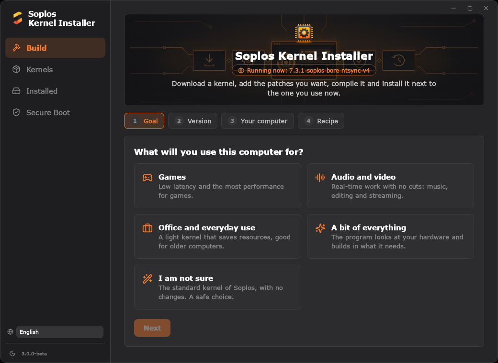
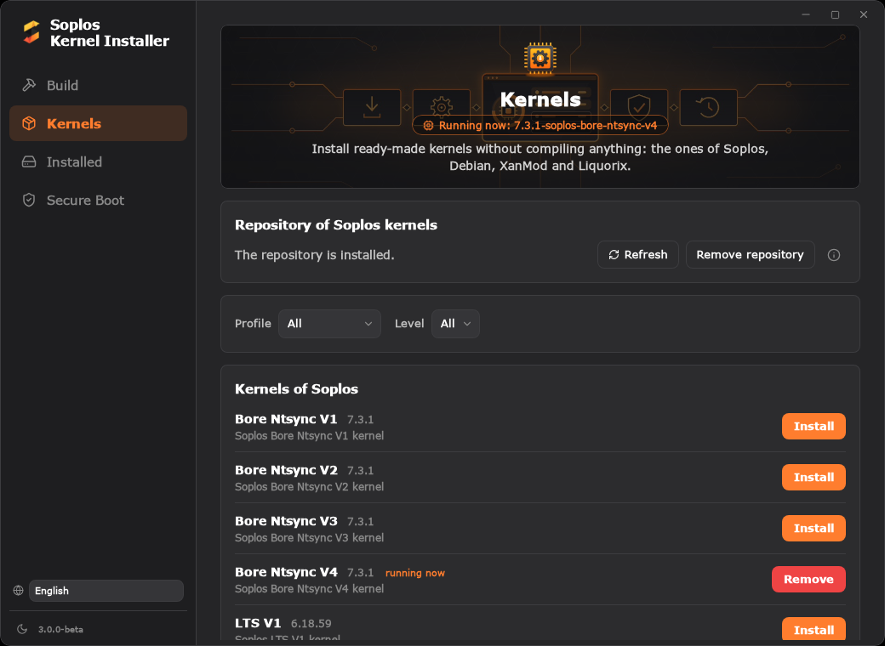
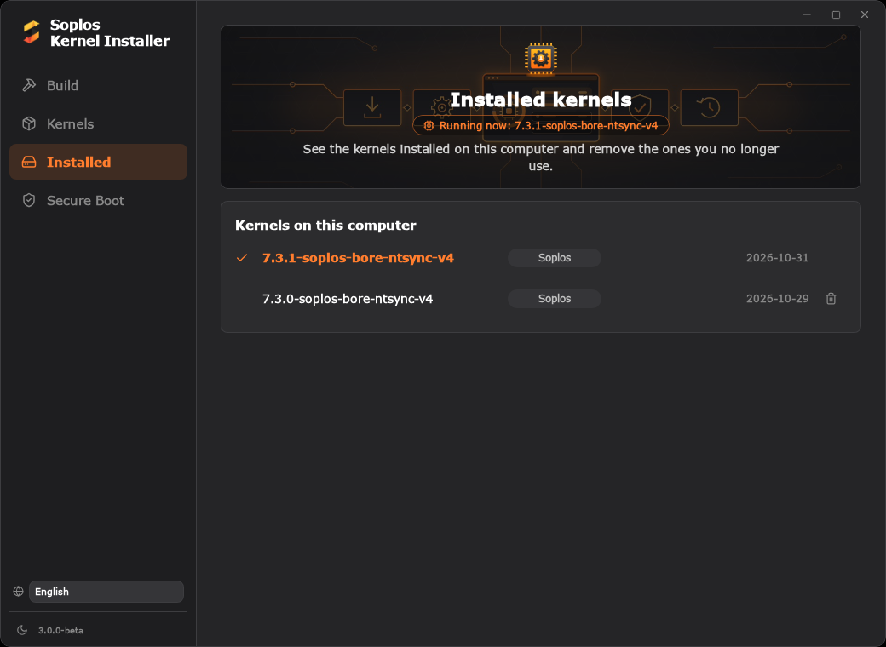
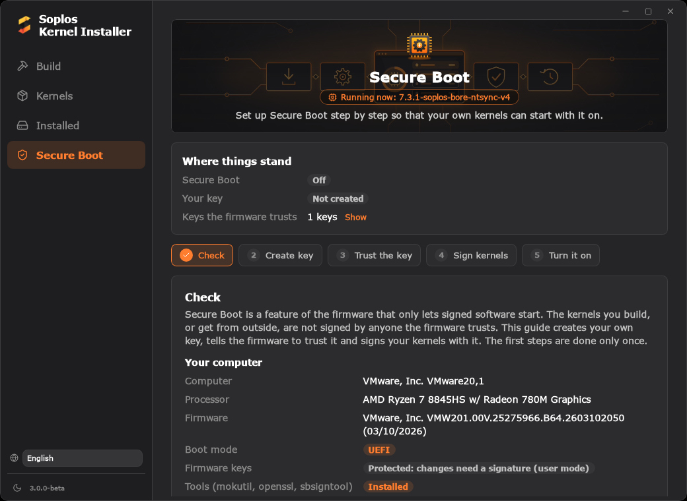

# Soplos Kernel Installer 3.0


Build and install Linux kernels on Soplos Linux.

Build your own kernel with an assistant, install ready-made kernels from Soplos, Debian, XanMod and Liquorix, see and remove the installed ones, and set up Secure Boot step by step for GRUB, systemd-boot and Limine.

|  The assistant to build a kernel asks first what the computer will be used for |  Ready-made kernels of Soplos, Debian, XanMod and Liquorix |
|:---:|:---:|
|  The kernels installed on this computer, with the one that is running marked |  The Secure Boot guide: where things stand and the five steps |

## Status

This is a beta of the rewrite of the 2.x program (Python 3 and GTK3), for the development team. It has not yet been tested with a complete kernel build on real hardware, nor with Secure Boot on a real firmware: report anything that fails.

## Features

- **Build**: an assistant. It asks what the computer is for (games, audio and video, office, a bit of everything or the standard kernel), which kernel is wanted, and what the computer is like, and it ends in a recipe that can be edited before the build. The kernels come from kernel.org: the newest stable one is recommended, the long-term ones are listed, and release candidates can be turned on to help Soplos find failures and make patches. The download is checked against the hash that kernel.org publishes. The patches come first from the rebases of Soplos, then from upstream; one that does not apply to that point release is not accepted. A build goes on while the page is left and can be cancelled.
- **Kernels**: installs and removes the ready-made kernels of Soplos, Debian (standard and real-time), XanMod and Liquorix, each with its own repository, added for you and taken away again if apt cannot read it.
- **Installed**: the kernels in `/boot`, with their profile, patches and date. It removes the ones that are not running, and offers to revoke the key of Secure Boot when nothing is signed with it any more.
- **Secure Boot**: a step by step guide. It shows the computer and the bootloader it detects, creates a key, makes the firmware trust it, signs kernels and bootloaders, keeps them signed after every update, and checks the whole chain before Secure Boot is turned on. GRUB and systemd-boot go through shim and the key of the user (MOK); Limine goes through the database of the firmware, with the hash of its configuration enrolled.
- **Batch** (hidden, Ctrl+Shift+D): builds a whole release of Soplos kernels one after another, 18 in all, into a folder that is chosen, each with its metapackage.
- **NVIDIA**: the driver sources that DKMS builds are patched for the new kernel before it is installed, and the result for its module is reported at the end. This is also done when a kernel of Soplos is installed or updated from the repository, and when this package is installed or updated, so the kernels that arrive later from a terminal build the module. On a computer with an NVIDIA graphics card, the package also installs a kernel hook that downloads the latest patches of the nvidia-patches project and applies them before DKMS builds the module.
- **Rust**: part of every kernel that has the Rust Binder (6.18 and newer), which is the only Binder built, for Waydroid. Older kernels are built without Binder and without Rust, and the program says so.
- **Light and dark theme** that follows the desktop, and a window with no frame of the system.
- **Eight languages**: English, Spanish, German, French, Italian, Portuguese, Romanian and Russian.

## Keyboard shortcuts

| Key | Action |
|---|---|
| F1 | About |
| Ctrl+1 to Ctrl+4 | Build, Kernels, Installed, Secure Boot |
| Ctrl+5 | Batch, when it is shown |
| Ctrl+Tab, Ctrl+Shift+Tab | The next page, the previous page |
| Ctrl+Shift+D | Show or hide Batch |
| Ctrl+Q | Quit |

## Architecture

A Rust backend and a Svelte 4 + Tailwind CSS frontend, rendered through the WebKitGTK of the system, with the layout of the other 3.0 programs (a sidebar, a hero on every page and a progress bar along the bottom edge).

- **Backend** (`src-tauri/src/`): `build/` (the list of kernels, the recipe, the patches, the configuration, the pipeline, the batch and the NVIDIA patches), `commands/` (what the pages ask), `privileged.rs` (the administrator steps), `secure_boot_ops.rs`, `limine.rs`, `bootloader.rs`, `signer.rs` and `kernel_sources.rs`.
- **Frontend** (`src/`): the sidebar, the pages Build, Kernels, Installed, Secure Boot and Batch, and the dictionaries of the 8 languages under `src/i18n/`.
- **Privileges**: the window never runs as root. What needs the administrator is asked as named operations under one polkit action, and each one is checked again as root. The password of the firmware goes through the standard input of the administrator step, never through a file.
- **Where it keeps things**: the builds in `~/kernel_build`, the key in `~/.config/soplos-kernel-installer/keys`, the history in `~/.local/share/soplos-kernel-installer`, and, only while the automatic signing is on, a copy of the key that only root can read in `/var/lib/soplos-kernel-installer`.

## Build

```bash
npm install
npm run tauri dev       # development (the right button of the mouse is on, for the inspector)
cargo test              # in src-tauri/; cargo test -- --ignored also tests against the network
./package.sh            # builds the .deb and copies it to Descargas and MEGA
```

## Project layout

```
src/                     Svelte interface (App, sidebar, pages, i18n)
src-tauri/src/           Rust backend
src-tauri/resources/     launcher, metainfo, polkit action, manual page and copyright
docs/                    source of the manual page
```

## License

GPL-3.0-or-later. Copyright 2026 Sergi Perich.

## Support

- Website: https://soplos.org
- Issues: https://github.com/SoplosLinux/soplos-kernel-installer-3.0/issues
